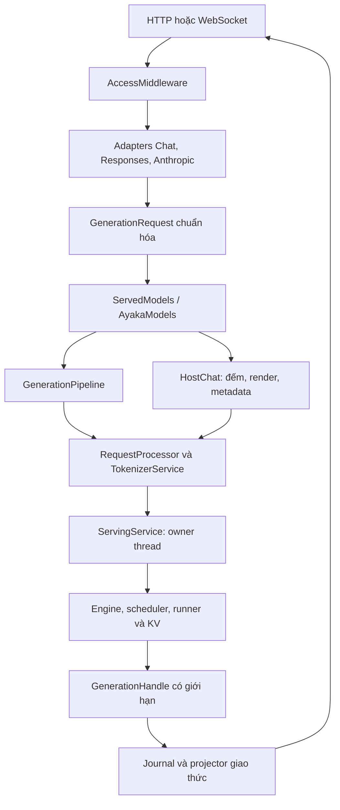

# Serving Rust → Python cho Ayaka

Ngày đối chiếu: 18/10/2026, giờ Việt Nam.

Repo gốc: https://github.com/gityuko-hb/ayaka-py

Commit cơ sở: `b3ab8959e7b6f1883c62b2eadeaaa5bc7563687d` (`main` tại thời điểm đọc).

## 1. Kết luận kiến trúc

Serving Rust được cung cấp chủ yếu là **lớp giao thức và cầu nối model source**.
Serving trong Ayaka hiện tại có phạm vi rộng hơn: vừa có HTTP, vừa có tiền xử lý,
admission, thread sở hữu engine, parser, thống kê, KV placement và KV transport.
Vì vậy, port Rust thành một lớp `serving/protocols/`, rồi nối vào pipeline Ayaka
đang có. Không tạo scheduler hay engine loop thứ hai.

Bản này đã nối các route mới vào `ayaka.serving.http.create_app`. Lời gọi
`NativeServingRuntime.create_app()` và CLI `python -m ayaka serve` tiếp tục đi qua
factory đó. Mã được sửa trên checkout cơ sở; gói bàn giao là patch và overlay để
áp dụng vào repo, không phải một bản phát hành đã triển khai.



HostChat gọi tokenizer và metadata; đường này không gọi `pipeline.reserve`,
`service.submit` hay scheduler. Việc tokenizer đã tồn tại trong một runtime có
GPU không có nghĩa là mỗi thao tác host sẽ tải hoặc giữ model thêm lần nữa.

## 2. Ánh xạ file

| Nguồn Rust | Python | Vai trò |
|---|---|---|
| `lib(2).rs` | `protocols/__init__.py`, `protocols/router.py` | Exports, lắp route, response identity và lifecycle |
| `source.rs` | `protocols/source.py` | Ports, request/control chuẩn hóa và sự kiện |
| `engine.rs` | `protocols/engine.py` | Adapter vào pipeline, invocation và host artifacts |
| `chat.rs` | `protocols/chat.py` | Chat request, lịch sử tool, JSON/grammar declaration, JSON/SSE |
| `responses.rs` | `protocols/responses.py`, `protocols/router.py` | Responses input/output, SSE, WebSocket và history |
| `anthropic.rs` | `protocols/anthropic.py` | Messages, thinking/tool replay, count_tokens và version |
| `error.rs` | `protocols/error.py` | ApiError và error envelope theo giao thức |
| `media.rs` | `protocols/media.py` | Data URL base64, giới hạn ảnh và body |
| `properties.rs` | `protocols/properties.py` | Metadata từ host; không đoán capability |
| `tests(1).rs` | Hai file `tests/test_serving_protocols*.py` | Chuyển các nhóm hồi quy quan trọng, thêm integration test |
| Kiểu thuộc `magnitude_chat` ở ngoài nguồn gửi kèm | `protocols/source.py`, `protocols/common.py` | DTO độc lập và Journal dùng chung |

Đây là bản port theo hành vi phù hợp với Python/Ayaka. Chưa thể coi là chứng minh
toàn bộ parity với runtime Rust: các crate `magnitude_chat`/`magnitude_engine`,
model weights và môi trường GPU của Rust không được cung cấp trong bộ nguồn này.

## 3. Bề mặt API đã triển khai

| API | Delivery | Ghi chú |
|---|---|---|
| `/v1/chat/completions` | JSON hoặc SSE | Một choice; tool/reasoning deltas; usage tùy chọn |
| `/v1/responses` | POST JSON hoặc SSE | Event sequence, output item lifecycle, metadata echo |
| `/v1/responses` | WebSocket | `response.create`, `generate:false`, continuation nội bộ connection |
| `/anthropic/v1/messages` | JSON hoặc SSE | Header `anthropic-version: 2023-06-01` |
| `/v1/messages` | JSON hoặc SSE | Alias giữ đường dẫn hiện tại của Ayaka |
| `/anthropic/v1/messages/count_tokens` | JSON | Host-only; có alias `/v1/messages/count_tokens` |
| `/api/v1/chat/templates/apply` | JSON | Host-only; khả năng introspection phụ thuộc HostChat |
| `/api/v1/models/{model_id}/properties` | JSON | Host-only; chấp nhận model ID có dấu `/` |
| `/v1/completions` | JSON hoặc SSE | Giữ qua adapter cũ vì không có endpoint tương ứng trong nguồn Rust |

Health, readiness, model list, stats, metrics và cache admin của app hiện tại được
giữ lại. Authentication và tenant salt dùng cơ chế hiện có, mở rộng cho alias
Anthropic và WebSocket. Standalone `protocols.router.create_app` là app dùng ports
cho kiểm thử/embedding; factory `serving.http.create_app` mới sở hữu auth/lifespan
của runtime Ayaka.

## 4. Quy tắc được giữ khi chuyển đổi

- Trường tương thích không biết được bỏ qua; trường đã biết phải đúng kiểu JSON.
  Không ép `true` thành số token, `1` thành cờ stream hay chuỗi thành temperature.
- Các message system/developer đầu lịch sử được ghép bằng newline. System xuất
  hiện giữa conversation bị từ chối. Assistant rỗng được bỏ qua.
- Tool call history yêu cầu ID duy nhất, arguments là JSON object và đầy đủ kết
  quả ngay sau lượt assistant. Tool output được sắp theo thứ tự call.
- Chat/Responses giữ giới hạn đầu ra là `None` khi client không cung cấp. Bridge
  Ayaka xác định giới hạn bằng context còn lại sau khi tokenize, thay vì tự gán 128.
  `/v1/completions` cũ giữ default hiện có. Reservation lớn hơn có thể ảnh hưởng
  admission/concurrency; muốn giới hạn server thì cần chính sách được công bố rõ.
- `top_k=0` của Rust được đổi thành `-1` ở sampler Ayaka. Seed bỏ trống được tạo
  mới; seed đã truyền được giữ. `cache_prompt:false` đi vào cả `prefix_cache`
  và `store_kv`. Extension Ayaka `timeout`, `min_tokens`, `stop_token_ids` được giữ.
- HTTP/SSE thường kiểm tra binding và admission trước khi trả header, nên lỗi
  prompt/context/model vẫn có HTTP status. Opt-in progress cho phép mở stream sớm;
  khi đó lỗi được trả trong stream. Có cả header `Magnitude-Include-Progress` và
  `Ayaka-Include-Progress`.
- Lỗi sau khi commit stream không được phát terminal thành công hay `[DONE]`.
  Nguồn kết thúc mà thiếu terminal cũng là lỗi, không phải output thành công rỗng.
- Stream close, client disconnect hoặc lỗi gửi header đều đóng invocation. Cleanup
  được bảo vệ khỏi việc ASGI hủy lặp lại trong khi cancellation đang thu hồi binding.
- Completed tool calls được giữ nếu đạt output limit giữa call sau. Call đang dở
  không vào kết quả cuối. Responses vẫn đóng item dở với status `incomplete`.
- Anthropic tách cache read khỏi input_tokens; message_delta mang usage tích lũy.
  Thinking có signature marker nội bộ để replay; đây không phải chữ ký của Anthropic.
- Chỉ ảnh base64 data URL; không tải URL mạng. Tối đa 8 MiB decoded/ảnh, kiểm tra
  cả trước và sau decode. Body mặc định 32 MiB; cấu hình giới hạn thấp hơn vẫn có hiệu lực.
- Billing attribution Claude Code chỉ bị bỏ khi sentinel đứng đầu và đúng hình
  `cch=` + năm byte + `;`. Gateway model alias chỉ xuất hiện ở response; model được
  bind vẫn là ID trong request.
- WebSocket chỉ giữ predecessor thành công gần nhất trong connection. HTTP vẫn
  stateless. Continuation thất bại sẽ loại predecessor tương ứng. History bị chặn
  bởi byte budget, có tối đa một request chờ trong inbox trong lúc đang generate.

## 5. Phân biệt khả năng giao thức và backend hiện tại

| Khả năng | Lớp port giao thức | Bridge Ayaka hiện tại |
|---|---|---|
| Text, sampling, stop, cache policy | Có | Có, đi qua pipeline cũ |
| Tool JSON/history và output streaming | Có | Parser/constraint backend hiện có; cần cấu hình tool parser với auto |
| Allowed-tools subset | Có | Lọc definitions rồi giữ mode auto/required |
| `parallel_tool_calls:false` | Giữ ý định | Required/named dùng grammar giới hạn một call; auto bị từ chối vì chưa enforce được |
| JSON object/schema | Giữ schema đã validate | Dùng constraint backend có sẵn; chịu các giới hạn GenerationSpec hiện tại |
| Raw grammar | Có declaration | Trả `unsupported_feature`; cần adapter raw grammar |
| Ảnh đầu vào | Có decode và validation | Trả `unsupported_feature`; chưa có nhánh vision preprocessing trong serving |
| Reasoning effort/budget | Có normalize và validation | Trả `unsupported_feature`; chưa có reasoning profile/budget bridge |
| `chat_template_kwargs` | Có bảo toàn | Trả `unsupported_feature`; chưa có mapping được kiểm chứng |
| Reasoning history/output | Có | Dùng dữ liệu template/parser hiện có; không suy ra khả năng điều khiển reasoning |
| Timings per token | Projector nhận được snapshot | Backend chưa phát snapshot tương ứng; response không bịa số timings |
| Breakdown reasoning tokens, stop_sequence | Ports hỗ trợ | ServingService chưa cung cấp đầy đủ metadata này |
| Host template/metadata | Có ports | Text render và suffix assistant từ cùng tokenizer; compiled grammar introspection còn thiếu |
| Template capabilities/model size/path/training context | HostChat có thể cung cấp đầy đủ | Capability chưa kiểm chứng là null; metadata không có thì không xuất số giả |
| Loading/inference progress | Có sự kiện và bounded callback | Model resident hiện tại không phát đầy đủ tiến trình; không suy diễn progress |
| Nhiều model/load/unload/residency | Có `ServedModels` seam | Adapter hiện tại chỉ một model đã resident |

`properties` mặc định của bridge vì vậy chưa có schema parity tuyệt đối với Rust.
Ứng dụng cần đầy đủ metadata có thể truyền HostChat đã được kiểm chứng vào
`AyakaModels(..., host=...)`, rồi bổ sung registry/model manifest trong giai đoạn sau.

Các mã lỗi thiết bị/load đặc thù Rust cũng chưa có phép tương đương một-một trong
runtime Ayaka. `ApiError` mang status/code/retryable; bridge giữ phân loại lỗi Ayaka
và cho phép model source tương lai cung cấp phân loại chính xác hơn.

## 6. Module serving hiện tại nên đi tiếp thế nào?

| Thành phần hiện tại | Hướng đi |
|---|---|
| `http.py` | Composition root: auth, giới hạn body, lifespan, health/admin; lắp protocol router |
| `protocol.py` | Adapter legacy cho completions; chỉ xóa các nhánh cũ sau khi kiểm tra import/client và chuyển hết compatibility code |
| `generation.py` | Giữ GenerationPipeline: admission phủ tiền xử lý đến khi frontend đóng request |
| `prepare.py` | Giữ bước canonical → Request; tách phần render dùng chung cho host/generation |
| `service.py` | Giữ owner thread: submit, engine step, terminal cleanup, bounded event publication |
| `parsers.py` | Giữ output parsing có trạng thái theo request; sau này thay bằng event parser của Generation mới qua cùng ports |
| `constraints.py` | Giữ cầu nối matcher/token mask; nối raw grammar qua backend Grammar thật trước khi công bố hỗ trợ |
| `events.py` | Sự kiện backend hiện tại; chuyển sang một event contract dùng chung khi Generation port đã sẵn sàng |
| `router.py` | Giữ KV-aware placement; khác nhiệm vụ với HTTP `protocols/router.py` |
| `migration.py`, `node_transport.py` | Giữ đường remote KV/PD; wire adapter không đọc hay đổi state các owner này |
| `stats.py` | Giữ metric ownership và client TTFT; tiếp tục đưa snapshot thật ra protocol ports |

Lộ trình đề xuất:

1. **Mốc hiện tại:** review/apply bản port, chạy contract tests và test model text
   trên môi trường của dự án. Chốt các thay đổi tương thích, nhất là output limit,
   Anthropic version và hành vi unknown fields.
2. **Generation + Grammar:** dùng chung request/output contract; đưa tool parser,
   reasoning budget và raw grammar vào đúng owner. Khi đó bỏ dần phần chuyển đổi
   trung gian `GenerationRequest → GenerationSpec`, không duy trì hai session loop.
3. **Host semantics:** model manifest, capability probes, reasoning profile,
   template kwargs và compiled-grammar metadata. Count/render/generate phải dùng
   cùng renderer và tokenizer, kể cả media expansion.
4. **Model source:** thay AyakaModels một model bằng registry quản lý phiên bản
   model, lease, loading và unload. Generation invocation giữ lease tới terminal
   hoặc cancel; host operations vẫn độc lập residency.
5. **Đo trước production:** real-model conformance, slow-client/disconnect soak,
   concurrent mixed requests, KV-pressure cases; đo client TTFT, ITL, throughput,
   event-loop lag, CPU time/token và số lần giữ/nhả admission. Chỉ benchmark này
   mới kết luận được ảnh hưởng hiệu năng của lớp Python.

Python phù hợp cho lớp giao thức I/O bất đồng bộ. Không có kết quả benchmark nào
trong bản bàn giao chứng minh overhead bằng 0 hoặc nhanh hơn Rust. Tối ưu GPU,
batching và KV vẫn cần đo trên engine thật.

## 7. Kiểm thử và phạm vi xác minh

Hai suite đi kèm bao phủ adapters, strict input, equivalent requests, model errors,
tool replay/cutoff, empty output, usage/cache, SSE terminal/error behavior, progress,
host-only operations, WebSocket history/disconnect và các đường integration.

Integration suite dùng TokenizerService, RequestProcessor, GenerationPipeline và
GenerationHandle thật; tokenizer adapter và service device execution được script.
Không tải weights, không khởi chạy scheduler/GPU. Có bài kiểm tra `_collect` của
ServingService để giữ nguyên nhân length/timeout khi đã có tool call.

Các sửa liên quan backend:

- `GenerationSpec.max_tokens` có thể là None; context còn lại được chốt sau tokenize.
- Count chỉ dành chỗ 0 output token. Render dùng cùng lock/budget với tokenizer.
- TemplateInput có cờ generation prompt để trả đúng suffix, thay vì nhầm toàn bộ
  prompt thành generation prefix.
- Parser giữ completed calls ở cutoff, không biến partial JSON thành tool call.
- Length và timeout có ưu tiên cao hơn `had_tools` ở terminal mapping.

Kết quả và lệnh thực tế được ghi trong `VALIDATION.txt` của gói bàn giao. Python
3.13 được dùng; môi trường kiểm tra cài tập dependency cần cho các suite thay vì
sync toàn bộ stack GPU. RTK không có trong môi trường này nên các lệnh tương đương
được chạy trực tiếp. Đây chưa phải full-repository CI hay kiểm chứng model/GPU.

## 8. Áp dụng vào repo

Đặt file `serving-python.patch` bên ngoài working tree cần sửa. Tại repo ở đúng
commit cơ sở, kiểm tra và áp dụng:

```bash
git apply --check /absolute/path/serving-python.patch
git apply /absolute/path/serving-python.patch
```

Hoặc đối chiếu/copy các file trong thư mục `overlay/`, theo đúng đường dẫn tương
đối tính từ root repo. Không dùng cả copy overlay lẫn apply patch lên cùng thay đổi.

Theo workflow của repo:

```bash
rtk proxy uv sync --group dev --extra cpu
rtk proxy uv run --no-sync pytest -q tests/test_serving_protocols.py tests/test_serving_protocols_ayaka.py
rtk proxy uv run --no-sync ruff check python/ayaka/serving tests/test_serving_protocols.py tests/test_serving_protocols_ayaka.py
```

Tests của repo đang bị ignore; khi chuẩn bị commit phải `git add -f` hai file test.
Nếu HEAD đã thay đổi, review diff và resolve trên branch riêng trước khi áp dụng.
CLI serve hiện tại tiếp tục là điểm khởi chạy; không cần một server thứ hai cho
package protocols.
